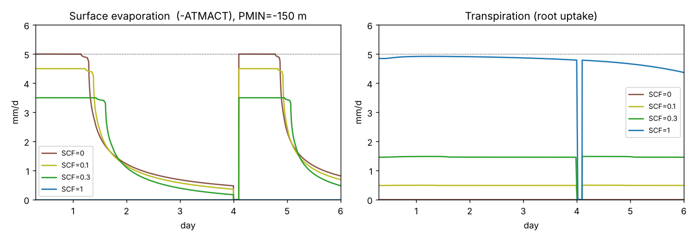
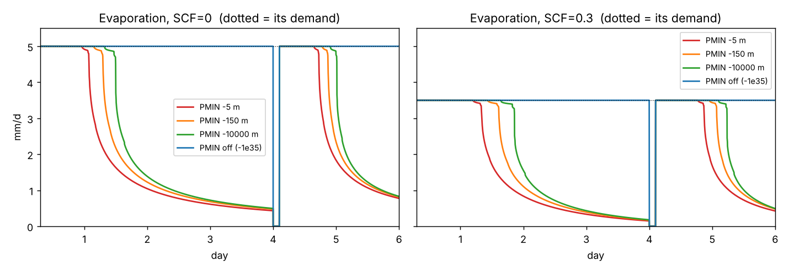
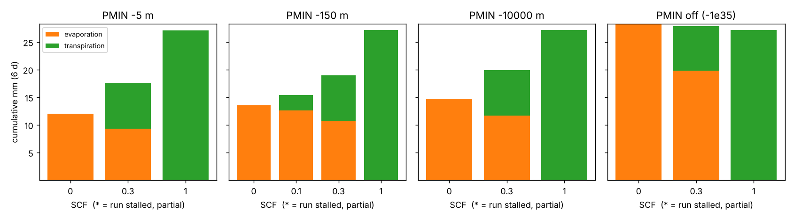
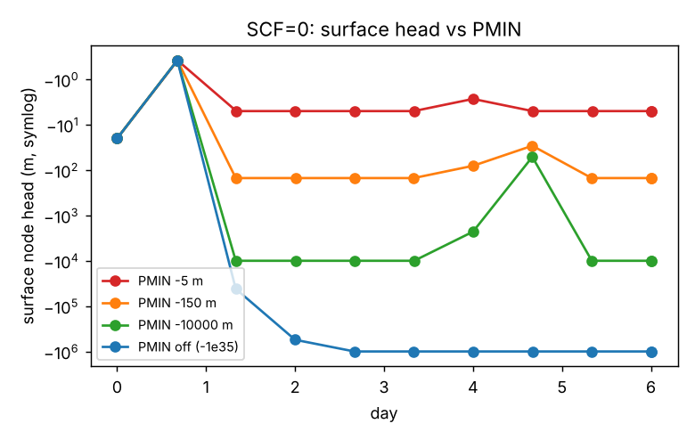
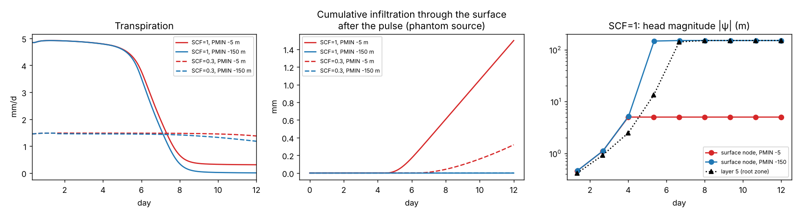
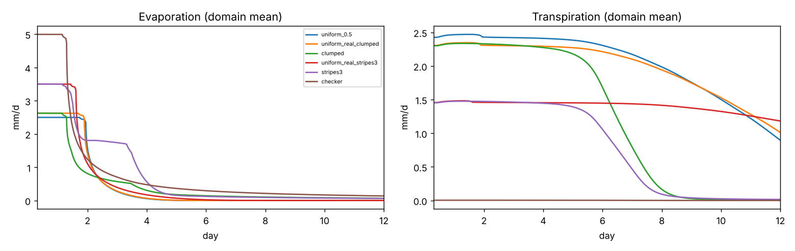
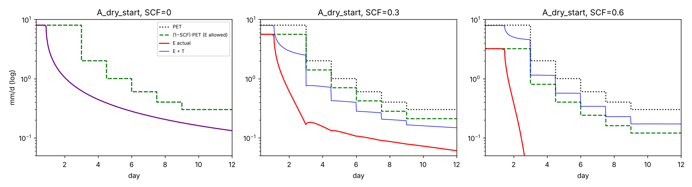

# SCF (float) vs SCF ∈ {0,1} and the role of PMIN — a CATHY smoke-test study for semi-arid conditions

Compares two CATHY builds driven through the `pycathy_wrapper` conventions:

| | source | how SCF is given |
|---|---|---|
| **classic** | `CATHY-Org/CATHY_src_org` @ `ef54607` (pinned by the wrapper) | one scalar, on the `IPEAT SCF` line of `input/soil` |
| **scf** (`SCF_variable`) | `CATHY-Org/CATHY_SCF_LAI` (main) | one value per vegetation type, on its own line after the Feddes table; `MAXVEG=15` |

Wrapper note: *"SCF = 1 → Feddes approach (all soil covered), SCF = 0 → PMIN approach"* — the experiments below test exactly that statement.

---

## 1. Findings in brief

1. **The new build reproduces classic at both endpoints.** SCF=0: E = 12.04 mm (PMIN −5) and 28.25 mm (PMIN off) in both builds. SCF=1: T = 27.09 / 27.08 mm (PMIN −5) and 27.14 mm in both (PMIN off). Fractional SCF only changes behaviour where classic cannot go.
2. **PMIN controls the *timing* of the evaporation switch, not the long-run rate.** Finite PMIN pins the surface node exactly at PMIN; evaporation then collapses from the demand to a soil-supplied rate that is almost PMIN-independent (≈ 0.5 mm/d at day 4 for PMIN −5 … −1e4). Stage-1 (demand-satisfied) evaporation lasts 1.07 d (−5), 1.29 d (−150), 1.48 d (−1e4).
3. **PMIN = −1e35 removes the soil limitation altogether.** Evaporation equals the full demand for the whole spell (28.25 mm at SCF=0, 19.78 mm at SCF=0.3 = 0.7 × 28.25), the surface node dries to **−2.8·10⁶ m (SCF=0)** / −1.6·10⁶ m (SCF=0.3), and cost explodes: 5 k → 32 k nonlinear iterations, 100 s → 586 s. No back-steps and the water budget still closes, so the run looks healthy while being unphysical.
4. **With 0 < SCF < 1 the two limiters are almost uncoupled.** Transpiration is ≈ 96–99 % of its demand (8.12–8.36 mm of 8.48) for *every* PMIN, while evaporation responds to PMIN as at SCF=0. Total ET therefore rises with SCF (13.6 → 19.0 → 27.1 mm for SCF 0 → 0.3 → 1 at PMIN −150) because transpiration draws on a root zone that the dry surface skin does not constrain.
5. **SCF=1 is only "pure Feddes" if PMIN ≤ PCWLT.** In the 6-day runs no hidden evaporation appeared (E = 0), but only because the surface never dried to PMIN. In the 12-day dry-down (§8) a PMIN of −5 m (the wrapper default) pins the surface node at −5 m while the root zone is at −150 m; the node then **injects water into the dry soil** (1.50 mm at SCF=1, 0.32 mm at SCF=0.3) and raises transpiration by 6 % (32.9 vs 30.9 mm). With PMIN = −150 m (= PCWLT) this phantom infiltration is exactly 0.
6. **Feddes does bite in a longer dry-down:** at SCF=1 transpiration falls from 4.9 mm/d to 0.01–0.3 mm/d between day 5 and day 8 as the root zone reaches PCWLT (§8).
7. **Bookkeeping trap:** `output/mbeconv` does not include the root-uptake sink. Its cumulative balance error equals the transpired volume (2.72 m³ at SCF=1). Add ∫QTRAN dt back: the residual is then ≤ 0.04 % of initial storage in all 17 runs.

8. **The "numerical issue" of classic with a float SCF was not reproduced; an accounting issue was** (§10). Classic and SCF build give the same E, T, iteration counts and zero back-steps for SCF = 0.3, even with PMIN disabled. They differ only when the root zone is very thin and PMIN is above PCWLT: classic then reports transpiration drawn from the pinned surface layer that the soil never loses (budget error 1.2 % of V0, ≈ 6 mm over 12 days; the SCF build: 0.03 %).
9. **ZROOT cannot replace a spatial SCF** (§9): at SCF = 1, ZROOT from 0.006 to 0.5 m changes transpiration (13.5 → 27.1 mm) but evaporation stays ≈ 0.
10. **A float SCF is not equivalent to a binary 0|1 map at equal mean cover** (§11): total ET is 19–29 % lower for the binary layouts. A float SCF is a sub-grid closure (roots integrate the whole cell); that assumption, not the solver, is the main structural uncertainty (§13).
11. **Release rule of the pinned node** (§12): inconsistent with the SCF partition on paper, no measurable effect in the ranges tested.






---

## 2. Physics, as read from the Fortran

### 2.1 Splitting the atmospheric demand (`atmnxt.f`, `atmone.f`, `atmbak.f`, `etran.f`)
* `ATMPOT` < 0 is evaporative demand. Evaporation is a **surface flux** `ATMACT = (1 − SCF)·ATMPOT`, updated **only while the node is flux-controlled (`IFATM = 0`)**.
* Transpiration is a **root-zone sink** `ETP = SCF·|ATMPOT|`, distributed over layers by root density, multiplied by the Feddes factor `GX = min(GX1, GX2)`: `GX1` rises linearly from 0 at PCWLT to 1 at PCREF (dry side), `GX2` is the anoxia limit at PCANA (wet side). Compensation (`OMGC`) lets unstressed layers take over, so total uptake ≈ `ETP·OMG/max(OMG,OMGC)`.
* `PMIN` does **not** appear in the root-uptake function. Feddes (`PCANA/PCREF/PCWLT`) is the only limiter of T; PMIN is the only limiter of E. (The SCF build additionally caps the top-layer withdrawal jointly; the repo's changelog describes it, and this study does not exercise it separately.)

### 2.2 The `IFATM` state machine and where PMIN enters (`switch_old.f`, `switch.f`, `adrstn.f`)
`IFATM` per surface node: 0 = Neumann (flux imposed), 1 = Dirichlet (head pinned: 0 when ponded-saturated, **PMIN when too dry**), 2 = ponded.
* Evaporative demand, `IFATM = 0`: if the solution gives `PNEW ≤ PMIN` the node switches to `IFATM = 1`, `PNEW = PMIN`. Thereafter the flux is **diagnosed** from the Darcy flux through the pinned node, i.e. soil-supply-limited ("stage 2").
* Release back to Neumann happens when rain/positive `ATMPOT` returns or the diagnosed flux can again meet the demand.
* Which routine runs: `ISIMGR = 0,1` → `SWITCH_OLD`; `ISIMGR = 2,3` (coupled surface; used here) → `ADRSTN` at the start of a step and `SWITCH` (called from `conver.f`, with the transpiration term `QTRANIE` in the demand difference).
* Consequence: **a finite PMIN is an artificial "air-dry" floor for the surface node.** −1e35 means `PNEW ≤ PMIN` never fires: the node stays flux-controlled forever and is asked to deliver `(1−SCF)·ATMPOT` no matter how dry the soil is; the solver complies by driving the head to astronomically negative values where K → 0.

### 2.3 Output differences
`fort.777`: classic writes transpiration only; the SCF build writes transpiration, evaporation and their sum. Here both builds are compared through `hgatmsf` (ATMACT, evaporation) and `fort.666` (QTRAN, transpiration), which exist in both.

---

## 3. Test bed
10 m × 10 m, 441 surface nodes × 16 node layers, 3 m deep (finest layer 6 mm), uniform soil, closed bottom/sides, uniform ψ₀ = −20 m.
Forcing (step, `IETO=1`): 25 mm rain (day 0–0.25) → 5 mm/d demand → 8 mm rain (day 4–4.1) → demand to day 6.
Vegetation: Feddes PCANA 0, PCREF −4 m, PCWLT −150 m, ZROOT 0.5 m, OMGC 1. `DTMAX` 1800 s, `ISIMGR = 2`.
Matrix: SCF build — SCF {0, 0.3, 1} × PMIN {−5, −150, −1e4, −1e35} plus SCF 0.1 at −150; classic — SCF {0, 1} × PMIN {−5, −1e35}. 17 runs; wall-clock cap 11 min (none hit it).

### Reproduce
**Primary route (pyCATHY `CATHY()` class): see §15** (`pycathy_module/scf_pmin_study.py`). The commands below are the *legacy direct runner* that produced the numbers in §1–§12; it calls the Fortran executables directly.
```bash
bash harness/build.sh harness              # builds bin/cathy_classic and bin/cathy_scf (needs gfortran, BLAS/LAPACK)
python3 harness/study_matrix.py            # ~1 h on one core -> harness/results/
python3 harness/analysis.py                # figures + summary_table.md
python3 harness/study_drydown.py && python3 harness/analysis_drydown.py   # §8 follow-up (4 runs, ~6 min)
pytest -v tests                            # 13 smoke tests, several minutes;  -m stress: PMIN-off stress tests;  -m drydown: 12-day tests
```
Environment pitfalls found: `Makefile` wants `conf_fac.f` but the file is `Conf_Fac.f` (handled by a symlink in the scratch copy); the SCF build's `etran.f` prints ~44 MB/hour of debug output (silenced in the scratch copy); **`MAXPRT = 9` in `CATHY.H` makes the model stop silently with exit code 0 if more than 9 print times are requested** (the runner asserts this); `input/vtk/` must exist when `VTKF ≠ 0`; and **`input/sfbc` ends at 604 800 s (7 days)** — a longer run stops with *"Fortran runtime error: End of file"* in `sfvnxt.f` (exit code 2). The template here sets the end time to 1e8 s (the value is constant 0, so earlier results are unaffected).

---

## 4. Results (6 days; E, T cumulative in mm)

| build | SCF | PMIN | E | T | E/(E+T) | stage-1 ends (d) | E @ day 3 (mm/d) | T @ day 3 (mm/d) | surface ψ min (m) |
|---|---|---|---|---|---|---|---|---|---|
| classic | 0 | −5 | 12.04 | 0 | 1.00 | 1.07 | 0.61 | 0 | −5 |
| classic | 0 | off | 28.25 | 0 | 1.00 | none (4.0*) | 5.00 | 0 | −2.8e6 |
| classic | 1 | −5 | 0 | 27.09 | 0 | – | 0 | 4.87 | −2.7 |
| classic | 1 | off | 0 | 27.14 | 0 | – | 0 | 4.87 | −3.0 |
| scf | 0 | −5 | 12.04 | 0 | 1.00 | 1.07 | 0.61 | 0 | −5 |
| scf | 0 | −150 | 13.58 | 0 | 1.00 | 1.29 | 0.68 | 0 | −150 |
| scf | 0 | −1e4 | 14.77 | 0 | 1.00 | 1.48 | 0.72 | 0 | −1e4 |
| scf | 0 | off | 28.25 | 0 | 1.00 | none (4.0*) | 5.00 | 0 | −2.8e6 |
| scf | 0.1 | −150 | 12.60 | 2.77 | 0.82 | 1.38 | 0.58 | 0.49 | −150 |
| scf | 0.3 | −5 | 9.29 | 8.36 | 0.53 | 1.34 | 0.33 | 1.48 | −5 |
| scf | 0.3 | −150 | 10.66 | 8.27 | 0.56 | 1.61 | 0.39 | 1.46 | −150 |
| scf | 0.3 | −1e4 | 11.65 | 8.25 | 0.59 | 1.83 | 0.43 | 1.45 | −1e4 |
| scf | 0.3 | off | 19.78 | 8.12 | 0.71 | none (4.0*) | 3.50 | 1.42 | −1.6e6 |
| scf | 1 | −5 | 0 | 27.08 | 0 | – | 0 | 4.87 | −2.8 |
| scf | 1 | −150 / −1e4 / off | 0 | 27.14 | 0 | – | 0 | 4.87 | −3.0 |

\* "4.0" is just the second rain pulse: the evaporation never dropped below 95 % of demand before it.
Surface ψ min is taken from the 9 saved print times (excluding t = 0). Full table with iteration counts and wall times: `results/summary_table.md`.

Solver cost (SCF = 0): nonlinear iterations 5.2 k (−5) → 9.2 k (−150) → 20.2 k (−1e4) → 31.8 k (off); wall time 102 → 171 → 365 → 586 s.

---

## 5. Discussion: how PMIN acts in each version

**SCF = 0 — "PMIN approach".** The whole demand is a surface flux, so PMIN is the *only* thing that stops evaporation from draining the soil. Small |PMIN| (−5 m) switches early (day ≈ 1.1) and yields the lowest E; a physically motivated air-dry value (−1e4 m, ≈ pF 6) delays the switch by only ~0.4 d and adds ~2.7 mm (+23 %) over the 6 days, at 3.5× the cost. The curves converge after the switch because the pinned node is supply-limited: PMIN decides *when* stage 1 ends and little else. At −1e35 nothing limits the surface; E = demand, a closed 3 m column loses its top soil to −10⁶ m. For semi-arid work this is the wrong end of the scale: real stage-2 evaporation is vapour/skin-limited, which is what the finite floor approximates.

**SCF = 1 — "Feddes approach".** E ≡ 0, so the evaporative switch has nothing to do and PMIN should be inert. In the 6-day runs it is: T = 27.08–27.14 mm for PMIN from −5 to −1e35. **That holds only while the soil stays wetter than PMIN**: in the 12-day dry-down a PMIN above PCWLT activates the switch on a stressed root zone and PMIN stops being inert (§8). Rule of thumb: keep PMIN ≤ PCWLT. Transpiration is limited only by Feddes (here the root zone stayed wetter than PCREF = −4 m, so uptake ≈ demand; 27.1 of ≈ 28.3 mm, the remainder being the days of rain). This setting cannot reproduce bare-soil drying, and it overstates ET when cover is sparse.

**0 < SCF < 1 — both limiters on one node, but not coupled.** E is capped by PMIN as at SCF=0 (scaled by 1−SCF), T by Feddes as at SCF=1 (scaled by SCF). Measured: T is within 1.3 % across PMIN −5…−1e4 (8.25–8.36 mm) and 98 % of demand, whereas E drops 20 % between PMIN −1e4 and −5. That is physically plausible for a sparse shrub canopy with a 0.5 m root zone, but means the partition is **fixed by the prescribed SCF, not by the soil state**: when the surface skin is dry, nothing shifts the unmet bare-soil demand to the roots, and nothing diminishes T when the skin is dry but the root zone moist. Semi-arid realism therefore depends mostly on (i) choosing SCF from cover/LAI, (ii) a finite, not too small PMIN, (iii) rooting depth and Feddes parameters.

**Small vs very large |PMIN| in one sentence:** small |PMIN| → early, strong self-limitation of E and a cheap solver; very large |PMIN| (−1e35) → the model *asks the soil for the demand regardless*, giving E = demand, head ≈ −10⁶ m, and a 6× slower run — only defensible as a deliberate "no soil limitation" control experiment.

---

## 6. Smoke tests (legacy pytest suite, `tests/` — superseded by the `CATHY()`-based module of §15, kept for provenance)

13 default tests + 2 stress tests, **all 15 passed** (11 min total):
1. both builds complete; outputs finite; water budget (`mbeconv` + root uptake) residual < 0.1 % of initial storage;
2. SCF=0 → T < 10⁻³ mm/d; SCF=1 with PMIN off → no evaporation;
3. SCF=0.3 right after the pulse → E ≈ 0.7·PET (±5 %), 0.15 PET < T ≤ 0.3 PET, E+T ≤ PET (no double withdrawal);
4. SCF build vs classic at SCF=0 (E) and SCF=1 (T): within 2 %;
5. cumulative E non-decreasing from PMIN −5 → −150 → −1e4; surface head never below a finite PMIN;
6. T at SCF=1 independent of PMIN (−1e35 vs −5) within 5 %;
7. (stress, `-m stress`) PMIN off with SCF 0 and 0.3 completes with finite heads.
8. (`tests/test_drydown.py`, `-m drydown`) 12-day dry-down: no infiltration through the surface after the pulse when PMIN = PCWLT (SCF 1 and 0.3); the same check at PMIN = −5 m is an explicit `xfail` documenting the known behaviour.

Smoke-test correction made along the way: the first version of test 1 used the wrong `mbeconv` column and reported a spurious 0.14 % error at SCF=0.3 (see finding 6).

---

## 7. Limits and open items
* One soil, one forcing, 6 days, a closed column with uniform properties: this isolates mechanism and ordering; it is not a calibrated arid-zone simulation. In the 6-day matrix, 33 mm of rain against 28 mm of demand keeps the root zone above −3 m, so Feddes never bites; §8 adds a 12-day dry-down to test the stressed regime (only 4 runs, SCF {0.3, 1} × PMIN {−5, −150}).
* The release-rule observation (tests compare with the full `ATMPOT`, not `(1−SCF)·ATMPOT`) was tested in §12: no measurable effect for PET ≳ 0.6 mm/d at PMIN −150 m; untested for PMIN −5 m over a very wet profile.
* `ISIMGR = 1` (`SWITCH_OLD` only, no surface routing) was not run.
* The SCF=0 regression against classic was first done at PMIN −5 and −1e35 (6 d); the `CATHY()`-based `quick` suite also covers PMIN −150 (1 d), identical to 4 digits.
* Per-run `psi_surf_min` stored in `results/summary.json` includes the t = 0 block and is not meaningful; use the table in §4. The field `mb_max_abs_rel_pct` in the same file is the old, wrong balance metric (replaced by `mb_residual_pct_V0` in the current code).

---

## 8. Follow-up: 12-day dry-down (stressed regime)

One 25 mm pulse at day 0, then 5 mm/d demand to day 12 (60 mm demand vs 25 mm supply); same soil, vegetation and grid. SCF build, SCF {0.3, 1} × PMIN {−5, −150}. All four runs complete in 86–117 s. (The first attempt crashed at day 7 on the `sfbc` end-of-file problem, §3.)

| SCF | PMIN | E (mm) | T (mm) | T @ day 8 / 11 (mm/d) | phantom infiltration (mm) | surface ψ, day 8–12 |
|---|---|---|---|---|---|---|
| 1 | −5 | 0.00 | 32.87 | 0.66 / 0.31 | **1.50** | −5 m (pinned) |
| 1 | −150 | 0.00 | 30.92 | 0.35 / 0.01 | 0.00 | −150 m |
| 0.3 | −5 | 5.46 | 17.25 | 1.47 / 1.43 | **0.32** | −5 m (pinned) |
| 0.3 | −150 | 6.32 | 16.53 | 1.42 / 1.26 | 0.00 | −150 m |

*Phantom infiltration* = ∫ max(ATMACT, 0) dt after the rain pulse, i.e. water that enters through the surface when only evaporative demand is imposed.



**Reading.**
* Feddes works as designed: at SCF=1 transpiration is ≈ 4.9 mm/d until day 5, then falls to ≈ 0 as the root zone (layer 5) reaches −150 m = PCWLT.
* With PMIN = −5 m the surface node reaches PMIN at day ≈ 4 while the soil beneath is still wetter (−2.5 m), but by day 6.7 the root zone is at −150 m and the pinned node (−5 m) is the *wettest* point in the profile. A Dirichlet node wetter than its neighbours is a water source: it infiltrates, at a roughly constant ≈ 0.2 mm/d at SCF=1 that is still growing at day 12. CATHY flags this itself in `output/hgflag` (≈ 2·10⁵ lines: *"INFILTRATION AT AN AIR DRY NODE WITH EVAPORATIVE POTENTIAL FLUX"*).
* The budget still closes (the source is counted as boundary inflow), so mass-balance checks do not catch it: at SCF=1 the water residual is 0.11 % of V₀ with PMIN −5 and 0.004 % with PMIN −150, because root uptake is bookkept separately (§1, item 7). Only the surface flux sign reveals it.
* At PMIN = PCWLT the surface node and root zone reach the same head, no gradient forms, and the phantom flux is zero.

**Consequence for semi-arid set-ups:** PMIN should be at least as negative as PCWLT whenever SCF > 0. A "small |PMIN|" such as the wrapper default −5 m is acceptable for bare-soil-only runs (SCF = 0, where it is a deliberate early evaporation cap), but combined with vegetation and a long dry spell it creates a numerical water source that props up transpiration.


---

## 9. Why a spatial SCF — and why not just change ZROOT per root-map class?

**What each parameter controls in the code.**
* `ZROOT` (per vegetation class, in the Feddes table) sets **down to what depth** roots take water: it only shapes the *vertical distribution* of the transpiration sink inside `etran.f`.
* `SCF` sets **how much of the atmospheric demand goes to the surface (evaporation, `(1−SCF)·ATMPOT`) and how much to the roots (transpiration, `SCF·|ATMPOT|`)**.
* With a global `SCF = 1` (classic "Feddes approach") there is no surface evaporation whatever `ZROOT` is. With `SCF = 0` there is no transpiration whatever `ZROOT` is. Classic SCF is one scalar for the whole domain, so a mosaic of bare soil and vegetation cannot be written at all.

**Experiment** (6-day forcing, SCF = 1, PMIN −150 m; `results_critique/zroot_table.md`):

| ZROOT (m) | E (mm) | T (mm) | NL iters |
|---|---|---|---|
| 0.006 (top layer only) | 0.02 | 13.46 | 9979 |
| 0.02 | 0.00 | 15.47 | 8739 |
| 0.1 | 0.00 | 21.29 | 6754 |
| 0.5 | 0.00 | 27.14 | 4689 |
| *SCF = 0, bare soil, ZROOT 0.5* | *13.58* | *0.00* | *9189* |

A 6 mm root zone gives about the same *total* water loss as bare soil (13.5 vs 13.6 mm) — a tempting shortcut — but it is wrong in the ways that matter: the loss is booked as **transpiration** (E ≈ 0), it stops at the wilting point (Feddes, −150 m) instead of the air-dry limit set by PMIN, it is a sink inside the soil rather than a surface flux, and it doubles the solver cost (10 k vs 4.7 k iterations). It also ties the *rooting depth* to the *cover*, which are different things (below).

**Semi-arid motivation.** Typical pixels (10–30 m) are mixtures of shrub/grass canopy and bare interspace. Between rain pulses, bare-soil evaporation (stage 1 → stage 2, controlled by PMIN) and root uptake (Feddes) are physically different limiters acting on different parts of the profile. A 0/1 SCF forces each pixel to be one or the other; a float SCF lets one pixel carry both.

**Post-fire motivation.** After a fire the canopy (LAI → SCF) collapses and then recovers over months, while the root system may survive (resprouters) or be lost; ash/char change the soil surface. Cover and roots evolve independently, so they need independent parameters: `SCF` for the canopy-driven partition, `ZROOT`/Feddes for the below-ground. A binary threshold on an LAI map makes pixels *jump* 0 → 1 (an artificial step in ET) during recovery; a float SCF follows the LAI change smoothly. What CATHY does **not** represent post-fire: hydrophobicity/reduced infiltration (only indirectly through top-layer Ks), ash layers, albedo/energy-balance changes, interception.

---

## 10. Classic vs the SCF build with a float SCF: is there a numerical problem, and what changed?

**What the repo itself says** (`SCF_intermediate_values_issue.md`): with 0 < SCF < 1 two *uncoordinated* withdrawals act on the same near-surface cell — the surface boundary-condition switch (PMIN) and the root-uptake sink — which could over-dry the cell and degrade convergence. The SCF build therefore (i) makes SCF an array per vegetation class (`MAXVEG = 15`), (ii) adds a "Level 1" joint cap in `etran.f` that withholds the top layer's uptake when the surface node is pinned at PMIN, (iii) refreshes the uptake after back-steps in `bkstep.f`, plus input/output format changes (11 files differ from classic).

**What I measured** (SCF = 0.3, same forcing and grid, both builds; `results_critique/classic_vs_scf_table.md`):

| scenario | classic E / T (mm) | NL iters | back-steps | budget resid % V0 | SCF build E / T (mm) | NL iters | back-steps | resid % V0 |
|---|---|---|---|---|---|---|---|---|
| ZROOT 0.5, PMIN −5, 6 d | 9.32 / 8.36 | 5139 | 0 | 0.007 | 9.29 / 8.36 | 5150 | 0 | 0.029 |
| ZROOT 0.5, PMIN −150, 6 d | 10.62 / 8.28 | 8751 | 0 | 0.028 | 10.66 / 8.27 | 8763 | 0 | 0.032 |
| ZROOT 0.5, **PMIN off**, 6 d | 19.78 / 8.12 | 32665 | 0 | 0.037 | 19.78 / 8.12 | 32665 | 0 | 0.037 |
| ZROOT 0.5, PMIN −5, 12 d | 5.64 / 17.26 | 4748 | 0 | 0.039 | 5.63 / 17.25 | 4748 | 0 | 0.017 |
| ZROOT 0.5, PMIN −150, 12 d | 6.49 / 16.53 | 6748 | 0 | 0.012 | 6.49 / 16.53 | 6748 | 0 | 0.012 |
| **ZROOT 0.02**, PMIN −5, 6 d | 6.91 / 8.42 | 5520 | 0 | 0.420 | 6.20 / 8.39 | 5573 | 0 | 0.189 |
| **ZROOT 0.006**, PMIN −5, 6 d | 9.87 / 8.42 | 5244 | 0 | **1.194** | 9.87 / 2.19 | 5244 | 0 | 0.025 |

**Reading.**
* **No convergence failure of classic with a float SCF** in any of these runs: iteration counts are identical or within 1.3 %, back-steps are zero, even with PMIN disabled. If your colleague saw non-convergence it was in conditions I did not test (see §13), or it was caused by something else (e.g. PMIN disabled on a large heterogeneous domain, which does cost 6× more iterations in *both* builds).
* **The difference is accounting, and it needs a thin root zone *and* PMIN above PCWLT.** For ZROOT = 0.5 m the top layer (6 mm) is ≈ 1 % of the root zone and the cap is invisible (≤ 0.3 %). At PMIN = PCWLT the Feddes factor at the pinned node is exactly 0, so the cap is inert too. With a 6 mm root zone and PMIN −5 m classic reports T = 8.42 mm and a budget imbalance of 1.19 % of initial storage (= 0.61 m³ ≈ 6 mm), roughly the T difference to the SCF build (6.2 mm). **My interpretation** (inferred from the budget, not traced in the Fortran): classic books uptake from a Dirichlet-pinned surface node that the soil never loses — phantom transpiration. The SCF build suppresses it.
* **The cap is not a complete fix in the intermediate case:** at ZROOT = 0.02 the SCF build still has 0.19 % budget error and 11 % lower E than classic. I did not investigate why.
* **So is the new version "better"?** In *capability* yes (a spatial SCF at all); in *accounting* yes in the corner above; in *numerical robustness* I could not show a difference. Do not present it as a convergence fix.

---

## 11. Heterogeneous cover: binary 0|1 maps vs a float SCF at equal mean cover

12-day dry-down, PMIN −150 m, 25 mm pulse, 5 mm/d demand. Two classes (SCF 0 and 1) in the vegetation raster vs uniform float SCF. **The vegetation raster is averaged onto nodes by `TRIANGOLI` and then truncated by `INT()` in `datin.f`**, so a node on a class-1/class-2 boundary (mean 1.5) becomes class 1 and a cell-scale checkerboard collapses to a single class. The *realized* cover (measured as 1 − E/PET before any pinning) is therefore reported instead of the nominal one.

| run | realized SCF | E (mm) | T (mm) | E+T (mm) | NL iters | back-steps | budget resid % V0 |
|---|---|---|---|---|---|---|---|
| uniform float | 0.500 | 5.14 | 24.15 | 29.29 | 6518 | 0 | 0.011 |
| uniform float | 0.475 | 5.30 | 23.45 | 28.75 | 6574 | 0 | 0.010 |
| clumped 0\|1 patches (left/right half) | 0.475 | 5.66 | 14.70 | **20.35** | 7101 | 0 | 0.008 |
| uniform float | 0.300 | 6.49 | 16.53 | 23.02 | 6748 | 0 | 0.012 |
| 3-cell 0\|1 stripes | 0.300 | 9.33 | 9.32 | **18.65** | 7280 | 0 | 0.008 |
| cell checkerboard 0\|1 | **0.001** | 10.01 | 0.03 | 10.04 | 6963 | 0 | 0.012 |



* At equal realized cover the binary layouts transpire 37–44 % less and lose 19–29 % less total water. In this closed column each tree pixel can only use its own water (no lateral supply), so SCF = 1 pixels deplete their column and are Feddes-stressed from day 5–8, while a float SCF spreads the demand over the same water and stays unstressed.
* Which one is "right" is a **sub-grid question the model cannot answer**: a float SCF implicitly assumes roots of the covered fraction reach the water under the bare fraction of the same cell; a binary map assumes they do not. Use a float SCF when canopy elements are smaller than the mesh cell, binary when the raster resolves individual plants.
* Cost: the binary layouts needed 8–9 % more nonlinear iterations (the Neumann/Dirichlet switching sits on more nodes); no back-steps anywhere. (Wall times were not compared reliably.)
* Observed, not investigated: the stripes run shows an evaporation plateau (≈ 1.8 mm/d) between day 2 and 3.5 that the uniform run does not; lateral redistribution across stripe boundaries is a possibility.

---

## 12. The release rule of the pinned surface node — explained, and tested

**Plain-language version.** When the surface node's head falls to PMIN the code *pins* it at PMIN ("the air is drying the soil faster than the soil can supply") and from then on evaporation is whatever the soil can deliver (a diagnosed flux). Each step the code asks: *may this node go back to flux control?* The answer is **yes only if it rains, or if the flux the soil can deliver exceeds the full potential demand `ATMPOT`** (`ATMACT < ATMPOT`, both negative, in `adrstn.f`, `switch_old.f` and `switch.f`).

**Why that is odd for 0 < SCF < 1.** The bare soil is only *asked* for `(1−SCF)·ATMPOT`, but the release test compares against the *full* `ATMPOT`. If the soil could deliver more than its allotted share but less than the full demand, the node stays pinned and evaporates *more than its share* (up to `SCF·PET` extra), and E + T could exceed PET.

**Test.** PET stepped down from 8 mm/d to 0.3–0.6 mm/d, so the "window" (soil flux between `(1−SCF)·PET` and `PET`) has a chance to open; SCF 0, 0.3, 0.6; (A) dry start, (C) water table 1 m below the surface. Numbers are E per PET stage / E allowed `(1−SCF)·PET` (mm/d):

| case | SCF | max E/allowed | E+T above PET (mm) | E / allowed in the last PET stages |
|---|---|---|---|---|
| A dry start | 0 | 0.60 | 0 | 0.24/0.60, 0.19/0.40, 0.15/0.30 |
| A | 0.3 | 0.37 | 0 | 0.10/0.42, 0.08/0.28, 0.07/0.21 |
| A | 0.6 | 0.03 | 0 | 0.00/0.24, 0.00/0.16, 0.00/0.12 |
| C water table | 0 | 0.23 | 0 | 0.16/1.50, 0.15/1.00, 0.13/0.60 |
| C | 0.3 | 0.01 | 0 | 0.00/1.05, 0.00/0.70, 0.00/0.42 |
| C | 0.6 | 0.00 | 0 | 0.00/0.60, 0.00/0.40, 0.00/0.24 |



**Result:** no violation. At PMIN −150 m the soil-limited flux of the pinned node decays to 0.1–0.5 mm/d, always **below** the share the SCF allows, so the window never opens unless PET falls to roughly that size (≲ 0.1–0.5 mm/d). Worst case the excess is bounded by that same magnitude. The inconsistency exists in the code but has no measurable effect in the tested range; low priority. (Not tested: PMIN −5 m with a very wet profile below, ISIMGR = 1.)

---

## 13. Critical assessment of using a float SCF

Plainly, in decreasing order of importance:

1. **The partition is prescribed, not simulated.** `SCF` fixes how the demand is split before the soil is consulted. Nothing shifts demand from a dried surface skin to the roots, nothing lowers transpiration when the canopy is stressed beyond the Feddes factor, and the two limiters (PMIN switch, Feddes) never see each other except through the shared near-surface cell. In my runs transpiration was 96–99 % of its demand for any PMIN while evaporation moved by 20 %: the partition is the input, not a result.
2. **It is a sub-grid closure with an unverifiable assumption** (§11). Equal mean cover can mean 19–29 % different ET depending on whether roots can reach the water under the bare fraction. Neither answer is validated here.
3. **SCF is a derived quantity with its own uncertainty.** `SCF = 1 − exp(−k·LAI)` (k ≈ 0.4–0.6, my assumption, not a repo default) inherits LAI-product errors (and sharpening artefacts), clumping, and saturation at high LAI. Errors of ±0.1 in SCF at low LAI are large relative to semi-arid ET.
4. **Static classes.** SCF is read once per run, per class (≤ 15 classes), so a continuous LAI map is discretised, and phenology within the run is not represented; a monthly restart (your practice) is a workable approximation, but **restart continuity was not tested here**.
5. **Raster-to-node conversion is lossy** (averaging then `INT()`): fine-scale patterns silently vanish (checkerboard → 0.001 cover). Check the realized cover (§11) rather than trusting the map.
6. **Interaction with PMIN is easy to get wrong.** PMIN must be ≤ PCWLT whenever SCF > 0 or the pinned surface node injects water into a stressed root zone (§8: 1.5 mm at SCF = 1, 0.32 mm at SCF = 0.3 over 12 days, growing). PMIN = −1e35 removes the only soil limitation on evaporation (heads to −10⁶ m, 6× the cost).
7. **No interception, no energy balance, no hydrophobicity/ash.** For post-fire sites these may dominate over the SCF choice.
8. **Everything here is model-vs-model on one closed 10 × 10 m column** (uniform soil, 441 nodes, 6–12 days). Not tested: steep slopes with active overland flow, rain exceeding infiltration capacity (ponding switches), heterogeneous soils, large meshes (the switching nodes grow with the mesh), time-varying hourly forcing, long runs. The repo's concern about degraded convergence for intermediate SCF may well show up there; **I could not reproduce it, which is not the same as showing it does not exist.**
9. **No field data.** Nothing above says the float-SCF partition is *correct* for a given site; it only says it behaves consistently and does not break the water budget.

---

## 14. Suggested workflow (semi-arid, post-fire recovery), and what to verify first

1. LAI (or effective LAI) raster → cover `SCF = 1 − exp(−k·LAI)` with k from the literature for the vegetation type; **bin SCF into ≤ 15 classes** (e.g. 0, 0.1, …, 0.9, 1) and write one vegetation class per bin (same Feddes/ZROOT unless the roots differ).
2. Set PMIN ≤ PCWLT (−150 m is a good default); avoid −1e35.
3. Update `root_map` + the per-class SCF line **between runs** (monthly in your case) from the new LAI; keep ZROOT/Feddes per class tied to rooting, not to canopy cover (post-fire: low SCF with deep ZROOT for resprouters).
4. After each run: add ∫QTRAN back into the `mbeconv` balance, check phantom infiltration (∫ max(ATMACT, 0) outside rain), and the realized cover (E/PET before pinning) against your intended SCF map.
5. Before trusting results: (i) aggregate the LAI map to 2–3 resolutions and see whether ET changes as in §11; (ii) test restart continuity (one run vs two chained half-runs); (iii) compare with soil moisture / ET data if available.


---

## 15. The `CATHY()`-based module (replaces the smoke tests)

`pycathy_module/scf_pmin_study.py` re-expresses every experiment of this study through the pyCATHY wrapper. All set-up and execution go through
`pyCATHY.cathy_tools.CATHY`: `CATHY(version="SCF_variable" | "1.0.0")`, `update_prepo_inputs`, `update_veg_map`, `update_soil(FP_map, SPP_map)`,
`update_atmbc`, `update_ic`, `update_sfbc`, `update_parm`, `run_processor(recompile=False, IPRT1=2)`.

```bash
python scf_pmin_study.py build            # one master project per version (clone + compile), ~1 min
python scf_pmin_study.py run quick        # 1-day invariants (the old smoke tests), ~12 min
python scf_pmin_study.py run drydown      # 12-day phantom-infiltration runs, ~8 min
python scf_pmin_study.py run matrix|release|hetero|critique   # the other blocks (matrix ~1 h, others 15-30 min)
python scf_pmin_study.py run all ; python scf_pmin_study.py compare
```
Structure: `Scenario` dataclass → suites (`suite_quick/matrix/drydown/release/hetero/critique`) → `run_one` (child process with a wall-clock cap, because `run_processor` has no timeout) → `collect`/`metrics` (E, T, budget residual *including* root uptake, phantom infiltration, realized cover, iterations) → `checks_*` (PASS/FAIL tables in `results/checks_*.md`). Dependencies: `pip install -e` of the wrapper, `gfortran`, BLAS/LAPACK, git.

### What was actually executed through the module
| suite | runs | outcome |
|---|---|---|
| `quick` | 8 | **16/16 checks PASS** (completion and budget, SCF=0 → T=0, SCF=1 → E=0, partition at SCF=0.3, E+T ≤ PET, SCF build ≡ classic at both endpoints, E monotone in PMIN, surface head ≥ PMIN, T independent of PMIN) — `results/checks_quick.md` |
| `drydown` | 4 | **4/4 PASS**: no phantom infiltration at PMIN = PCWLT (0.000 mm), phantom infiltration at PMIN −5 m (1.496 mm at SCF 1, 0.319 mm at SCF 0.3) — `results/checks_drydown.md` |
| `matrix`, `release`, `hetero`, `critique` | – | **defined, not re-executed through the module** (hours of single-core time). Their numbers in §1–§12 come from the legacy direct runner. |

**Agreement with the direct runner** (12 runs, `results/module_vs_direct.md`): maximum relative difference in E and T **0.07 %**; nonlinear iteration counts identical in 9 runs and within 1.4 % in the others (pyCATHY writes the forcing with 3 significant digits and integer seconds). This is the evidence that the module reproduces the study; it does not extend to the four suites not re-run.

### pyCATHY pitfalls found while building it (all worked around in the module)
1. `update_soil()` calls `set_SOIL_defaults()` internally and **silently resets PMIN to −5 m** unless *both* `FP_map` and `SPP_map` are passed explicitly. With SCF=1 this is a trap (§8).
2. `update_veg_map()` / `update_soil()` trigger a **mesh-building run and leave `parm` in mesh-only mode (`IPRT1=3`)**; a following `run_processor()` then rebuilds the mesh in 0 s and reports stale outputs. Force `IPRT1=2` after the setters.
3. Deleting `output/` from a copied project makes `CATHY.__init__` try to remove a non-existent `tmp_src`; deleting only `grid3d` makes `run_processor` re-run the mesh. Keep `grid3d`/`grid2d.exp`, drop the other (stale) result files.
4. `update_cathyH()` (called by `run_processor(recompile=True)`) rewrites `src/CATHY.H` with tight dimensions (`MAXVEG=1`, `NFACEMAX=2205`) — unusable for multi-class maps.
5. `recompileSrc()` compiles with `gfortran -O -mcmodel=large -fPIC`; **the resulting binary segfaults (`connection_new_`) with gfortran 13.3 on this grid**, while the upstream Makefile (`-O3`) runs. Not root-caused. The module compiles with the Makefile (`SCF_STUDY_COMPILER=pycathy` selects the wrapper's compiler where it works).
6. The shipped `input/sfbc` ends at 7 days (a longer run stops with *End of file*, exit 2): `update_sfbc(time=[0, 1e8], no_flow=True)` fixes it. `MAXPRT = 9` (in `CATHY.H`) silently stops runs with more than 9 print times; `update_cathyH` would raise it but only with a recompile.

### Legacy files
`harness/` (direct runner, matrix/extra/critique drivers, analysis) and `tests/` (pytest) are kept because the numbers of §1–§12 were produced with them; they are superseded by the module and not maintained. At the last run the pytest suite had: 15/15 original tests passing, 2 passed + 2 expected failures in `test_drydown.py`, and 4 of 5 quick tests of `test_extra.py` passing when observed (the fifth was still running; the slow `-m release` and `-m hetero_long` tests were never executed).
